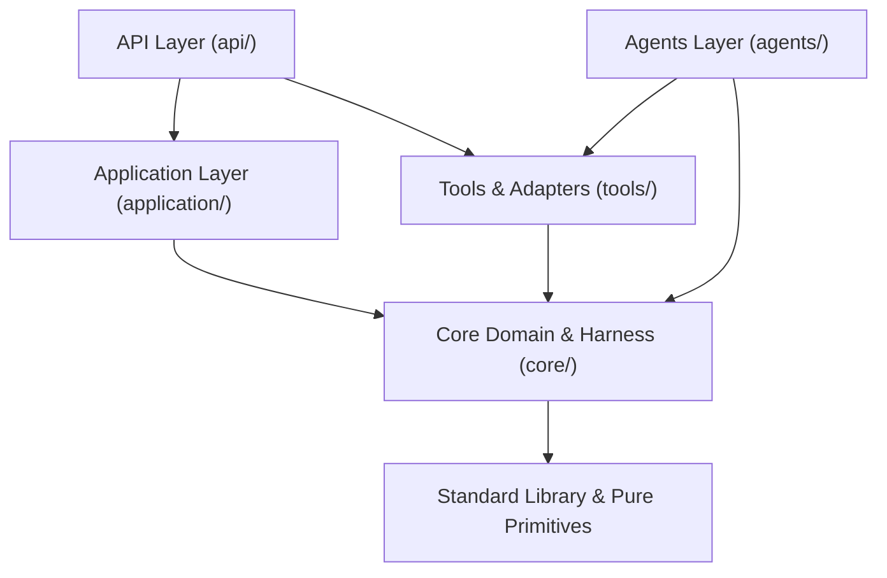

# AGENTS.md — System Architecture & Coding Standards (Trinity Wealth Engine)

> Single Source of Truth for all AI coding agents working on `invest-agents`.

---

## 1. ⚙️ Exact CLI Commands

| Task | Command |
|---|---|
| **Python Dependencies** | `uv sync` |
| **Backend Tests** | `.venv\Scripts\pytest tests/ -v` |
| **Frontend Tests** | `npm --prefix web test -- --run` |
| **Frontend Typecheck** | `npm --prefix web run typecheck` |
| **Update Golden Manifests** | `.venv\Scripts\python scripts/generate_golden_manifests.py` |
| **Backend Dev Server** | `.venv\Scripts\python -m uvicorn api.main:app --port 8000 --reload` |
| **Frontend Dev Server** | `npm --prefix web run dev` |

---

## 2. 🏛️ Architecture & 16 AST Dependency Rules

The project strictly follows Hexagonal Architecture enforced by AST tests (`tests/architecture/test_dependency_rules.py`):

- **Domain Isolation:** `core/` and domain models must NOT import frameworks, adapters, SQLite, or API layers.
- **Application Isolation:** `application/` interacts with ports and interfaces, not concrete third-party network adapters.
- **Lower Layer Isolation:** `tools/`, `agents/`, and `application/` must NEVER import `api.*`.
- **DAO Transaction Isolation:** Raw DAOs must never call `.commit()` or `.rollback()` directly; all transactions are managed by `UnitOfWork`.
- **System Locator Rule:** No dynamic `sys.modules[...]` service locator lookups in production code.

---

## 3. 🛡️ Hard Rules (Always / Ask First / Never)

### ✅ Always
1. **Atomic File Writes:** Use atomic swap (`_atomic_io.py`) for all file modifications to prevent corruption.
2. **Deterministic Financial Math:** Compute all financial numbers, yields, and allocation weights using Python tools with `Decimal` (never let LLM calculate mentally).
3. **Green Test Gate:** Verify that both relevant backend pytest suites and frontend vitest/typecheck pass before finishing any task.
4. **Wrap Agent Tools:** ReAct agents must use `ProgressiveToolRegistry` and `wrap_tools_with_harness()` from `core/tool_harness.py`.

### ⚠️ Ask First
1. **Database Schema Changes:** Always ask before altering SQLite tables, migrations, or database layouts.
2. **Adding Dependencies:** Always ask before adding new Python or npm packages.
3. **Regenerating Manifests:** Always ask before running `generate_golden_manifests.py` or changing contract baselines.

### ❌ Never
1. **No LLM Mental Math:** Never generate financial numbers directly from LLM prompts.
2. **No Manual Manifest Edits:** Never edit `tests/fixtures/manifest_*.json` by hand.
3. **No Filesystem I/O in Routers:** `api/routers/` must delegate business logic and I/O to application services or adapters.
4. **No Direct Commit in DAOs:** Never invoke `.commit()` inside repositories or DAOs.
5. **Do Not Touch `agents/bookkeeper_agent.py`:** Reserved for dedicated refactoring.

---

## 4. 🗺️ Context Map (Nested Scoping)

For detailed domain-specific conventions, refer to the nested `AGENTS.md` files:
- [Agents Guidelines](file:///c:/ChinoDoc/Projects/Claude/invest-agents/agents/AGENTS.md): Tool harness, prompt loading, LangGraph ReAct agents.
- [API Guidelines](file:///c:/ChinoDoc/Projects/Claude/invest-agents/api/AGENTS.md): REST endpoints, saga orchestrators, lease fencing, status codes.
- [Web Guidelines](file:///c:/ChinoDoc/Projects/Claude/invest-agents/web/AGENTS.md): React 19, Vite, TypeScript, Tailwind/CSS conventions.
