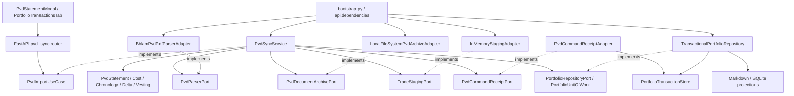

# แผนพัฒนาระบบนำเข้า BBLAM PVD ด้วย Hexagonal Architecture

วันที่จัดทำ: 2026-10-13  
ฉบับ: Revision 6 — ทบทวน serialization, snapshot replay, retry/concurrency และเส้นทางแก้ไขข้อมูลร่วมกับโค้ดปัจจุบัน  
สถานะ: แผนงานสำหรับนำไปพัฒนา; ยังไม่ได้เพิ่มฟีเจอร์ PVD หรือรันชุดทดสอบฟีเจอร์ใหม่  
ต้นฉบับ: [pvd_transaction_import_hexagonal_plan.md](C:/Users/GnoMark/.gemini/antigravity-ide/brain/1014285d-f139-4a7d-a684-b116f20152a2/pvd_transaction_import_hexagonal_plan.md)

## 1. ผลลัพธ์และขอบเขต

ผู้ใช้เปิดหน้า Portfolio Transactions กด “อัปเดต PVD กองทุนสำรองเลี้ยงชีพ” อัปโหลด Statement PDF ของ BBLAM ใส่รหัสผ่าน ตรวจสอบข้อมูล และยืนยันเพื่อนำยอดของงวดนั้นเข้า Portfolio ที่เลือก

ผลลัพธ์ต้องครอบคลุมความสามารถตามต้นฉบับ:

- อ่านข้อมูลกองทุน สมาชิก นายจ้าง ช่วงเวลา เงินสะสม เงินสมทบ ผลประโยชน์ และกองทุนย่อยทั้ง 6 ของรูปแบบตัวอย่าง
- แปลงวันที่ พ.ศ. เป็น ISO ค.ศ. และคำนวณด้วย `Decimal` ก่อนแปลงเป็น DTO
- จัดสรรต้นทุนจากเงินต้นสะสมรวมตามมูลค่าของแต่ละกองทุนย่อย พร้อมจัดการเศษสตางค์
- แยกสินทรัพย์ด้วย `asset_type="PVD"`, `bucket_id="retirement_pvd"`, `currency="THB"`, `cash_adjusted=False`
- นำเข้าครั้งแรกและอัปเดตงวดถัดไปโดยยอดหน่วยและต้นทุนตรงกับ Statement ล่าสุด
- แสดง NAV จาก Statement พร้อมวันที่ และข้ามผู้ให้บริการราคาหุ้น/กองทุนสาธารณะสำหรับ PVD
- มี Dedicated Modal พร้อมการ์ดสรุป ตารางกองทุนย่อย และ Vesting Slider 0–100%
- รองรับ Remember password แบบผู้ใช้เลือกเอง ตาม Feature C ในต้นฉบับ
- ป้องกันเอกสารซ้ำ เอกสารตัวเลขขัดแย้ง และเอกสารย้อนหลังตาม Feature D
- เก็บ PDF ต้นฉบับและข้อมูลอ้างอิงที่เชื่อมกลับไปยังรายการใน Ledger ได้

ระยะนี้รองรับรูปแบบ Statement BBLAM ที่มีข้อมูลข้อความและตาราง ไม่รวม OCR, Email Sync, การคำนวณภาษีตามกฎหมาย, การเดาตารางสิทธิตามอายุงาน หรือการนำเข้าประวัติย้อนหลังเพื่อสร้างกราฟผลตอบแทน

## 2. ผลตรวจโค้ดและจุดที่ปรับจาก Revision 4

| ประเด็น | สิ่งที่พบในโค้ด/เอกสาร | ข้อกำหนดในแผนนี้ |
| --- | --- | --- |
| Replay ใช้ `Net_Amount` | `_replay_symbol_trades()` ใช้ยอดนี้เป็นต้นทุนของ `BUY` จริง แต่สะสมหน่วยทุกครั้ง | ใช้รูปแบบ snapshot สำหรับยอดสิ้นงวด ไม่ส่งยอดทั้งหมดเป็น `BUY` ทุกงวด |
| งวดถัดไป | ต้นฉบับมีชื่อ Delta Engine แต่ยังไม่มีวิธีจัดการหน่วยลดลง หน่วยเท่าเดิมแต่ต้นทุนเปลี่ยน หรือกองทุนที่ปิดแล้ว | กำหนด `PVD_SNAPSHOT` เป็นยอดเป้าหมายต่อกองทุน และแสดง delta ใน preview |
| ความแม่นยำ | Replay ปัด average cost เป็น 4 ตำแหน่ง; `recalc_all()` ใช้หน่วย × ราคา/ต้นทุนแบบ float | เก็บมูลค่าและต้นทุนจาก Statement เป็น Decimal ที่ serialize เป็น string และเพิ่มการคำนวณเฉพาะ PVD |
| Canonical import model | `TradeImportItem.action` รับเฉพาะ `BUY/SELL`; `bucket_id` ยังไม่มี field ชัดเจน | เพิ่ม action และ metadata ที่จำเป็น โดยรักษาพฤติกรรมรายการซื้อขายเดิม |
| Batch importer | บันทึก `Net_Amount` และ `Cash_Adjusted` แต่ยังไม่ตั้งราคาปัจจุบันหรือ bucket จาก item | ให้ PVD service ใช้ UoW ของ repository โดยตรง; reuse staging และ identity helpers |
| ผู้ให้บริการราคา | ชื่อ class จริงคือ `CompositeMarketPriceAdapter`; fund provider ปัจจุบันคือ `FinnomenaFundAdapter` | แก้ guard ใน class และ method ที่มีอยู่จริง รวมถึง single-price และ fundamentals |
| Repository | มี `TransactionalPortfolioRepository` และ `PortfolioTransactionStore` เป็นแหล่งข้อมูล; Markdown/SQLite mirror เป็น projection | ใช้ repository port เดิมและ transaction stream เดิม ไม่สร้าง Ledger อีกชุด |
| Staging | `TradeStagingPort` มี items, provenance, session binding และ TTL 1,800 วินาที | ใช้ instance ระดับ process จาก composition root; ผูก provenance กับพอร์ตและ source ด้วย |
| ตัวเลขตัวอย่าง | ตารางต้นทุนในต้นฉบับรวมถูก แต่ต้นทุนบางแถวไม่ตรงสูตรที่ระบุ | ใช้ผลคำนวณ Decimal ในหัวข้อ 4 เป็นเกณฑ์ใหม่ และตรวจ PDF จริงอีกครั้ง |
| ไฟล์ตัวอย่าง | ไม่พบ `media_1791880593793.pdf` ใน workspace หรือโฟลเดอร์ต้นฉบับที่ระบุ | เป็น dependency ของการยืนยัน parser กับเอกสารจริง; ไม่ถือว่าผ่านจากข้อมูลใน Markdown |

**ข้อปรับสำคัญ:** เป้าหมาย “Zero Drift” ต้องทดสอบจากยอดจริงหลัง commit, recalc และ replay จึงจำเป็นต้องเพิ่มความสามารถเฉพาะ PVD ใน replay/calculations ไม่คงคำรับรองว่าไม่ต้องแก้ไฟล์เหล่านี้เลยหรือไม่มี regression โดยปราศจากหลักฐานทดสอบ

### ผลรีวิว Revision 5 และสิ่งที่แก้ใน Revision 6

| ระดับ | จุดผิดพลาด/ช่องว่างที่พบ | ข้อแก้ไข |
| --- | --- | --- |
| สูง | `json.dumps(state.model_dump())` ใน SQLite mirror ยังรับ Decimal/date ไม่ได้; CSV writer/migration เลือกเฉพาะ `_TRADES_LOG_HEADER` จึงทิ้ง metadata ใหม่ | กำหนด wire format, JSON-mode serialization และเพิ่มคอลัมน์ metadata พร้อม round-trip tests เป็นงานบังคับ |
| สูง | Replay เดิมคืนเพียง tuple ของตัวเลข ไม่คืน NAV/valuation/Statement metadata | เพิ่ม pure PVD replay result และ projector; tuple เดิมเป็น compatibility output ไม่ใช่แหล่ง exact valuation |
| สูง | Receipt ตรวจเพียงก่อนรอ lock; concurrent requests ยังผ่านพร้อมกันได้ และ response เดิมอาจทำให้ UI ถอยกลับไปงวดเก่า | ตรวจซ้ำใน lock, ป้องกันเขียนทับ receipt ที่ request hash ต่างกัน และ response อ่าน state ปัจจุบัน |
| สูง | ป้องกัน edit/void เฉพาะ transaction แต่ generic Holding trade/correction/remove/import-overwrite ยังทำลายยอดหรือประวัติ PVD ได้ | เพิ่ม guard ระดับ service ทุกเส้นทางและทดสอบ batch แบบไม่เปลี่ยนข้อมูลบางส่วน |
| สูง | Reset แล้ว receipt/preview เก่ายังอยู่ และ baseline พอร์ตว่างอาจเหมือนก่อน reset | เพิ่ม persisted import epoch และตรวจ epoch ของ scan/receipt ก่อนใช้ |
| กลาง | สูตร allocation ใช้ raw value แต่ข้อ invariant ให้ใช้ adjusted valuation | ใช้ฐานเดียวกันหลัง reconciliation และกำหนด tolerance/residual ที่ตรวจสอบได้ |
| กลาง | `ActualPortfolioStateDTO`/`ActualHoldingDTO` ไม่ได้ประกาศ metadata ใหม่ จึงถูกตัดก่อนถึง UI | เพิ่ม DTO fields ชัดเจนและทดสอบ state reload พร้อม generated contracts |
| กลาง | State route สั่ง fundamentals อัตโนมัติสำหรับทุก holding ที่ timestamp ว่าง | ยกเว้น PVD ที่ route และ adapter เพื่อไม่เกิด write/refresh ซ้ำทุก GET |
| กลาง | การเพิ่ม target 0% เปลี่ยนชุด Buckets แต่แผนเดิมห้ามแก้ origin metadata พร้อมกัน | รักษา policy/percent เดิม แต่ mark allocation origin ว่าชุด targets ถูกปรับ และป้องกันการย้าย PVD ไป bucket อื่น |
| กลาง | Analyze ที่ block ยังไม่ชัดว่า stage/archive หรือคืน HTTP error; memory staging ไม่รองรับหลาย process | กำหนด preview response, nullable scan ID, single-process deployment และพฤติกรรมเมื่อ restart |

## 3. สถาปัตยกรรมและทิศทาง dependency



- Domain PVD ใหม่ใช้ standard library เท่านั้น: dataclass, Decimal, datetime, enum และ typing
- Domain ไม่ import FastAPI, PDF libraries, adapters, database, filesystem หรือ browser storage
- Ports อ้างอิง domain contracts; shared `TradeImportItem` เดิมยังเป็น Pydantic model ตามโครงสร้างที่มีอยู่
- Service รับ ports ผ่าน constructor และไม่สร้าง adapter หรือ import concrete repository
- Router inject `PvdImportUseCase` ผ่าน provider ใหม่ ไม่เข้าถึง private field ของ `PortfolioService`; inbound contract มี analyze, commit และการอ่านเอกสารที่ตรวจ committed reference แล้ว
- PDF/password handling อยู่ใน parser adapter; archive path resolution อยู่ใน archive adapter
- `bootstrap.py` เป็นจุดประกอบ adapter; UI อ่านข้อมูลผ่าน API เท่านั้น

## 4. ข้อกำหนด Domain และตัวเลข

### 4.1 Models และผลลัพธ์แบบมีชนิด

เพิ่มใน `tools/portfolio/domain/pvd_models.py`:

- `PvdSubFundHolding`: code, name, units, statement NAV, statement market value, weight และ allocated cost
- `PvdContributionSummary`: เงินต้น/ผลประโยชน์/ยอดรวมของสมาชิกและนายจ้าง รวมถึงเงินสะสมสมาชิกในปีตามเอกสาร
- `PvdStatement`: fund/member identity, as-of date, period, holdings และ summary
- `PvdHoldingValuation`: exact units, NAV, market value, cost basis, as-of date และ cost-basis method
- `PvdStatementMetadata`: identity, semantic fingerprint, raw PDF hash, archive ID, วันที่และสถานะการนำเข้า
- `PvdSnapshotReplayResult`: latest complete Statement, exact valuation รายกอง, closed symbols และข้อมูลที่ใช้สร้าง Holding

`PvdScanResult` และ `PvdCommitResult` เป็น dataclass contracts ที่ประกาศใน `ports/pvd_port.py` เพราะต้องอ้าง shared `TradeImportItem`/`PortfolioState`; ไม่ให้ `pvd_models.py` import shared models ย้อนกลับจนเกิด circular dependency เมื่อ `Holding` เพิ่ม `PvdHoldingValuation`

ใช้ `date` ภายใน domain และแปลง ISO string ที่ขอบ API; ระบุ money quantum `0.01` บาท ส่วนหน่วย/NAV เก็บความละเอียดต้นฉบับ ไม่ปัดให้ตรงกับจำนวนตำแหน่งที่ UI แสดง

เพิ่ม `Holding.pvd_valuation` และ `PortfolioState.pvd_statements` เป็น typed optional metadata พร้อม `payload_version=1` โดยข้อมูลเก่าที่ไม่มี PVD ยังโหลดได้ เพิ่ม `PortfolioState.pvd_import_epoch` เป็น token ที่สร้างและบันทึกครั้งเดียวเมื่อเตรียมพอร์ตสำหรับ PVD ไม่สร้าง token ใหม่ทุกครั้งที่อ่าน state; full reset ต้องเปลี่ยน token นี้

เพิ่ม `pvd_valuation` ใน `ActualHoldingDTO` และ `pvd_statements` ใน `ActualPortfolioStateDTO` อย่างชัดเจน เพราะ DTO ปัจจุบันตัด unknown fields; decimal metadata ใช้ string และ date ใช้ ISO ทั้ง response หลัง commit และ GET state หลัง restart

### 4.2 Cost allocation และการปัดเศษ

สำหรับกองทุนย่อย i:

```text
valuation_i = statement_market_value_i + reconciliation_adjustment_i
raw_cost_i = valuation_i × total_contribution / total_nav
allocated_cost_i = ROUND_HALF_UP(raw_cost_i, 0.01)
residual = total_contribution - sum(allocated_cost_i)
allocated_cost_largest += residual
average_cost_i = allocated_cost_i / units_i
```

เลือกแถวที่มี valuation เป็นบวกมากที่สุดเพื่อรับ residual; หากเท่ากันใช้ sub-fund code เรียงอักษรเป็น tie-breaker จัด adjustment ก่อน allocation เสมอ และตรวจว่า valuation/cost หลังปรับไม่ติดลบ เก็บต้นทุนรวมเป็นค่าที่ authoritative ส่วน average cost เป็นค่าหารที่มี Decimal precision เพียงพอสำหรับแสดง ไม่ใช้ average cost ปัดเศษคูณกลับเพื่อสร้างต้นทุนรวม

ต้นทุนรายกองเป็น **ต้นทุนจัดสรรตามสัดส่วน** เพราะ Statement ไม่มีต้นทุนซื้อรายกอง ไม่เรียกว่า historical acquisition cost ที่ยืนยันจากรายการซื้อขาย

ผลคำนวณจากตัวเลขใน Markdown ต้นฉบับ:

| กองทุนย่อย | มูลค่าตาม Statement (บาท) | ต้นทุนจัดสรร (บาท) | ผลประโยชน์จัดสรร (บาท) |
| --- | ---: | ---: | ---: |
| SINSA_FI | 39,853.95 | 32,300.74 | 7,553.21 |
| SINSA_ASIA | 100,209.34 | 81,217.44 | 18,991.90 |
| SINSA_GLOB | 119,944.87 | 97,212.65 | 22,732.22 |
| SINSA_GTO | 40,082.87 | 32,486.27 | 7,596.60 |
| SINSA_CARE | 39,493.07 | 32,008.25 | 7,484.82 |
| SINSA_GOLD | 49,289.35 | 39,947.92 | 9,341.43 |
| **รวม** | **388,873.45** | **315,173.27** | **73,700.18** |

อัตราส่วนต้นทุนคือประมาณ `0.810477727394349`; ผลประโยชน์หารเงินต้นสะสมปัดเป็น `23.38%` ตัวเลขเหล่านี้เป็นผลตรวจสูตรจาก Markdown ยังไม่ใช่ผลตรวจ PDF

กรณี total NAV เป็นศูนย์อนุญาตเฉพาะไม่มีหน่วยและไม่มีต้นทุน; หากมีเงินต้นหรือหน่วยแต่ NAV เป็นศูนย์ให้ปฏิเสธ ไม่หารด้วยศูนย์

### 4.3 Invariants และความละเอียดของ Statement

- ตรวจยอดสมาชิก/นายจ้างแต่ละส่วน = เงินต้น + ผลประโยชน์ และยอดรวมสมาชิก + นายจ้าง = total NAV; เงินต้นสมาชิก + นายจ้าง = total contribution; เงินต้นรวม + ผลประโยชน์รวม = total NAV สำหรับยอด summary ที่แสดงถึงสตางค์ต้องเท่ากันหลัง normalize เป็น `0.01` บาท หากไม่เท่ากันให้ block ไม่ปรับเงินของสมาชิก/นายจ้างเพื่อให้ผ่าน
- ตรวจ `abs(sum(sub_fund_market_values) - total_nav) <= 0.05` บาทตามต้นฉบับ; ถ้าต่างแม้อยู่ใน tolerance ให้แสดงยอดต่างและบันทึก adjustment ที่ตรวจสอบได้
- เมื่อยอมรับยอดต่างดังกล่าว ให้เก็บค่ารายแถวต้นฉบับไว้ และกระจาย reconciliation adjustment ไปแถว market value เป็นบวกสูงสุดก่อน cost allocation โดยใช้ tie-breaker เดียวกับ residual; ใช้ adjusted valuation เป็นฐานคำนวณและแสดง adjustment ใน preview หากปรับแล้วติดลบหรือไม่มีแถวที่รับ adjustment ได้ให้ block
- ผลรวม allocated cost ต้องเท่ากับ total contribution ถึงสตางค์หลังจัด residual
- ห้ามค่า NaN/Infinity, หน่วยติดลบ, NAV ติดลบ, เงินต้นสะสมติดลบ และรหัสกองทุนย่อยซ้ำ; ผลประโยชน์อนุญาตติดลบเพื่อรองรับงวดขาดทุน และตรวจหน่วยบวกต้องมี NAV บวก
- ถือว่า `0 units / 0 value / 0 cost` เป็นแถวปิดกองทุนที่ถูกต้อง; หากหน่วยเป็นศูนย์แต่ยังมีมูลค่าหรือต้นทุนให้ปฏิเสธ
- ต้องแยกความผิดพลาดจาก parsing กับส่วนต่างที่เกิดจาก NAV แสดงแบบปัดเศษ
- ตรวจ period start ไม่เกิน period end, วันที่ as-of อ้างอิงวันที่ยอดคงเหลือจริง และ weight เป็นตัวเลข 0–100; weight ที่แสดงปัดเศษต้องตรวจด้วย precision ของเอกสาร ไม่ตั้งสมมติฐานว่าผลรวมเท่ากับ 100 แบบไม่มี tolerance

ตัวอย่างต้นฉบับ `2,907.4195 × 13.7077 = 39,854.03428015` แต่ระบุ market value `39,853.95` ต่างกันประมาณ `0.08428` บาท จึงไม่ใช้เงื่อนไข `units × NAV == market_value ± 0.01` แบบ trade confirmation โดยตรง ต้องยืนยัน units/NAV/มูลค่าจาก PDF ก่อนกำหนด tolerance รายแถวของรูปแบบ BBLAM นี้

หาก PDF ยืนยันความต่างดังกล่าว ให้เก็บ `statement_nav` และ `statement_market_value` แยกกัน โดย valuation ใช้มูลค่าที่เอกสารรายงานหลัง reconciliation และ UI แสดงความต่าง ไม่เปลี่ยน NAV เป็นราคาที่คำนวณย้อนกลับแล้วเรียกว่า NAV ต้นฉบับ

Tolerance ของ units × NAV ต้องอิง precision ที่แสดงจริง สำหรับ profile ที่ยืนยันว่าใช้การปัดใกล้สุด ให้ bound เป็น `abs(units) × half_nav_quantum + abs(nav) × half_units_quantum + half_units_quantum × half_nav_quantum + half_money_quantum` และระบุ rounding convention ใน parser profile หากส่วนต่างเกิน bound ให้ block แม้ผลรวมยอดทั้งเอกสารตรงกัน; ถ้าต้นฉบับใช้วิธีอื่นต้องยืนยันและกำหนด profile ก่อนเปิด commit ไม่ใช้ tolerance กว้างโดยไม่มีหลักฐาน

### 4.4 Vesting และข้อมูลเงินสะสมในปี

```text
vested_value = member_total_balance
             + ROUND_HALF_UP(employer_total_balance × vesting_percent / 100, 0.01)
```

ใช้ Slider 0–100% ค่าเริ่มต้น 100%; ถือเป็นสมมติฐานของผู้ใช้สำหรับประเมินสิทธิ ไม่เปลี่ยนยอดรวมใน Ledger ตัวอย่าง 0% = `213,712.95`, 50% = `301,293.20`, 100% = `388,873.45` บาท

แสดง `24,036.65` เป็น “เงินสะสมสมาชิกในปีตาม Statement” พร้อมปีที่ได้จากเอกสาร ไม่ hardcode 2026 และไม่รับรองว่าเป็นยอดลดหย่อนที่ใช้ได้ทั้งหมด หากไม่มีข้อมูลให้แสดงว่าไม่พบข้อมูลแทน `0.00`

## 5. การนำเข้า ยอดงวดถัดไป และ Ledger Replay

### 5.1 สัญญารายการ PVD

ขยาย canonical `TradeImportItem` ให้รองรับ `PVD_SNAPSHOT` และ field PVD ที่จำเป็น แต่จำกัด action นี้ให้ `source="BBLAM_PVD"`, `asset_type="PVD"`, THB และ `cash_adjusted=False`

| Field | ค่า/ความหมาย |
| --- | --- |
| `symbol` | `PVD_{sub_fund_code}` เช่น `PVD_SINSA_FI` |
| `action` | `PVD_SNAPSHOT` — กำหนดยอดสิ้นงวด |
| `units` | หน่วยเป้าหมายล่าสุด ไม่ใช่หน่วยเพิ่ม |
| `price` | NAV ที่เอกสารแสดง |
| `gross_amount` | มูลค่าต้นฉบับของแถวตาม Statement |
| `net_amount` | ต้นทุนที่จัดสรรแล้ว |
| `fees` | ศูนย์ทุกประเภท |
| `bucket_id` | `retirement_pvd` |
| `cash_adjusted` | `False` |
| PVD metadata | fund/member scope, exact valuation, reconciliation adjustment, as-of date, archive ID และ statement fingerprint |

ใช้ validator เฉพาะ PVD; ไม่ลดความเข้มงวดของ reconciliation สำหรับ `BUY/SELL` เดิม และ generic batch importer ต้องปฏิเสธ `PVD_SNAPSHOT` หากถูกส่งเข้าเส้นทางซื้อขายปกติ

ระยะนี้รักษาชื่อ symbol ตามต้นฉบับและรองรับหนึ่ง PVD account ต่อพอร์ต โดยตรวจ fund code + member identity เมื่อเปลี่ยน account ต้องปฏิเสธการรวมอัตโนมัติ หากต้องรองรับหลาย account ที่ใช้ sub-fund code เดียวกัน ให้พัฒนาการ namespace symbol เป็นงานต่อยอด

### 5.2 Reconciliation และ replay

`PvdDeltaReconciliationEngine` คำนวณ `new_units - old_units`, `new_cost - old_cost` และ `new_value - old_value` เพื่อแสดงการเปลี่ยนแปลง ผล commit ยึดยอดเป้าหมายเต็มของ Statement ไม่อนุมานว่า delta เป็นการซื้อ/ขายจริง

- ครั้งแรก: สร้าง snapshot จากทุกกองทุนย่อยที่ถูกต้อง
- งวดใหม่: append snapshot ใหม่ แล้ว replay กำหนด units และ total cost เป็นยอดใหม่ของแต่ละกอง ไม่บวกยอดเก่า
- หน่วยเพิ่ม ลด หรือเท่าเดิมแต่ต้นทุน/NAV เปลี่ยน: ใช้กฎ snapshot เดียวกัน
- กองทุนเดิมหายจากเอกสารใหม่: สร้างแถวปิดยอดศูนย์ได้เมื่อ parser ยืนยันว่าเอกสารครบและการไม่มีแถวหมายถึงไม่มีการถือครอง; ถ้ายืนยันไม่ได้ให้ block แทนการเดา
- Snapshot ไม่สร้าง realized P&L และไม่เปลี่ยนเงินสด; mixed ordinary trades กับ snapshot ใน symbol PVD เดียวกันต้องถูกปฏิเสธในระยะนี้
- ประวัติ snapshot ทุกงวดคงอยู่; chronology และ duplicate ตรวจจากรายการ active ที่ไม่ถูก void พร้อม metadata ของ Statement

เพิ่ม pure helper สำหรับ replay/project PVD โดยอ่าน `PVD_Metadata_JSON` ของ snapshot rows เป็น `PvdSnapshotReplayResult` แล้วสร้าง units, NAV, exact valuation/cost, asset type, bucket และ Statement metadata จากผลเดียวกัน เส้นทาง commit และ rebuild ใช้ helper นี้ร่วมกัน

เพิ่ม branch สำหรับ `PVD_SNAPSHOT` ใน `_replay_symbol_trades()` โดยกำหนด units held และ cumulative cost จากข้อมูลของแถว ห้ามหารด้วยศูนย์เมื่อปิดกอง และยังคืน tuple เดิมเพื่อรักษา callers แต่ tuple นี้ไม่พอสร้าง PVD Holding จึงห้าม caller ใช้เพียง final units/final average แล้วละ metadata

สำหรับ PVD ให้ `recalc_holding`, `compute_total_cost`, `recalc_summary` และ `recalc_fundamentals_derived` ใช้ exact market value/cost จาก metadata ที่ตรงกับ snapshot active ล่าสุด: `unrealized_value = valuation - cost` และ `unrealized_percent = unrealized_value / cost × 100` ไม่ใช้ NAV ปัดเศษหาร average cost เพื่อคำนวณเปอร์เซ็นต์ กรณี cost เป็นศูนย์ให้ percent เป็น `None` แล้วส่ง float เฉพาะ projection ของ DTO เดิม

ตรวจ complete Statement group ด้วย required symbol set/count และ fingerprint ก่อน replay: มีหนึ่ง snapshot ต่อ symbol ต่อ Statement รวมแถวปิดยอดที่ service สร้าง; การมี duplicate แถว, metadata ไม่ครบ, payload version ไม่รองรับ หรือ scope ปะปนต้องเป็น error ไม่เลือกแถวล่าสุดตาม Transaction ID แบบสุ่ม

PVD legacy ที่มีเพียงชื่อ `PVD_` หรือ metadata ไม่ครบต้องแสดงว่า migration required และ block การ update/recalc ที่จะเดายอด; ไม่สร้างต้นทุนหรือสรุป scope จาก prefix เพียงอย่างเดียว แผนระยะนี้ไม่ทำ silent migration ของ PVD เก่า

ทดสอบทั้ง replay ของ trade rows และ replay ของ `PortfolioTransactionStore`; ห้ามให้เส้นทาง rebuild/edit/void คืนยอด PVD ต่างจากเส้นทาง commit

### 5.3 Identity, chronology และ concurrency

ใช้ scope `(portfolio_id, fund_code, normalized_member_id)` โดย `portfolio_id` แยกผ่าน repository อยู่แล้ว และใช้ member hash ใน persisted identity:

```text
confirmation_no = PVD_{fund_code}_{member_hash}_{YYYYMMDD}
order_id = PVD_{sub_fund_code}_{YYYYMMDD}
identity = (confirmation_no, order_id)
```

คำนวณ semantic fingerprint v1 จากข้อมูลต้นฉบับที่ normalize แล้ว: fund/member scope, period/as-of, contribution/balance/benefit และ holdings ที่เรียงตาม code รวม units/NAV/market value ไม่รวม allocated cost, residual, baseline-dependent closing rows, filename, archive ID, password, Notes, parser version หรือข้อมูลสุ่ม Decimal ใช้ canonical numeric string ที่ทำให้ `1.0` กับ `1.00` เท่ากัน; parser/allocation version เก็บเป็น provenance แยกเพื่อไม่ให้การอัปเกรดสูตรทำให้เอกสารเดิมกลายเป็น conflict

| เปรียบเทียบกับงวด active ล่าสุดใน scope เดียวกัน | ผลลัพธ์ |
| --- | --- |
| ยังไม่มีข้อมูล | นำเข้าครั้งแรกได้ |
| วันที่ใหม่กว่า | preview การอัปเดตและ commit ได้ |
| วันที่เท่ากันและ semantic fingerprint ตรง | `already_imported`, ไม่มี mutation เพิ่ม |
| วันที่เท่ากันแต่ข้อมูลต่าง | conflict; block commit และให้ตรวจเอกสาร |
| วันที่เก่ากว่า | แสดงย้อนหลัง; block commit |
| Scope กองทุน/สมาชิกไม่ตรงกับ PVD ในพอร์ต | block เพื่อป้องกันรวม account |

ตรวจตอน analyze และตรวจซ้ำภายใน UoW lock ตอน commit โดยเรียง receipt → scope/epoch → semantic duplicate → baseline/chronology ถ้า request เดิมหรือ Statement เดิมถูก commit ระหว่างรอ lock ให้คืนผลที่บันทึกแล้ว; หากเป็นคนละงวดที่ทำให้ preview เก่าให้คืน conflict

Baseline digest ใช้ economic identity/metadata ของ PVD active snapshots และ valuation ที่เกี่ยวข้อง ไม่รวม Notes, last_updated, fundamentals timestamp หรือธุรกรรมคนละสินทรัพย์ ก่อน apply โหลด state ล่าสุดใน lock แล้วปรับเฉพาะ PVD เพื่อไม่เขียน cash/holdings อื่นทับด้วย state ที่เคยอ่านตอน analyze

นำเข้าทั้ง Statement แบบ atomic: `selected_item_ids` หากยังคงอยู่ใน contract ต้องเป็นชุดครบของรายการที่ต้องปรับยอด ห้ามเลือกเพียงบางกองทุนแล้วแสดง aggregate ว่านำเข้าสำเร็จครบ งวดที่เป็น duplicate ทั้งฉบับแสดงรายละเอียดและ Badge ได้โดยไม่มีรายการให้ commit

### 5.4 ป้องกันการแก้ไขผ่านเส้นทางร่วม

Guard ต้องอยู่ใน service ก่อน mutation ไม่พึ่งการซ่อนปุ่ม UI อย่างเดียว:

- Manual BUY/SELL, generic batch import และ holding-import ต้องปฏิเสธ PVD symbol/type รวมกรณีเปลี่ยน asset type เพื่อหลบ guard
- Holding correction ต้องห้ามเปลี่ยน units/cost/type/valuation ของ PVD; transaction edit อนุญาตเฉพาะ note และต้องคง exact metadata
- Single/batch remove รวม hard purge ใน `PortfolioTradingService` และ state-only remove ใน `PortfolioStateService` ต้องปฏิเสธเมื่อกระทบ PVD; mixed batch ต้อง reject ทั้งคำสั่งก่อนปรับสินทรัพย์อื่น
- Holding-import แบบ overwrite ต้องปฏิเสธเมื่อพอร์ตมี PVD เพราะโค้ดเดิมล้าง non-cash holdings; append ของสินทรัพย์อื่นต้องรักษา PVD และไม่รับ PVD rows
- Generic bucket assignment/reassignment และแผน Buckets จาก Investor Essence ต้องรักษา `retirement_pvd`; target upsert ต้องไม่ลบ bucket นี้ขณะมี PVD
- Full reset ที่ผู้ใช้ยืนยันแล้วทำได้ทั้งพอร์ต แต่ต้องล้าง PVD rows/metadata, เปลี่ยน `pvd_import_epoch` และทำให้ scan/receipt จาก epoch เก่าใช้ปรับหรือคืน state เดิมไม่ได้ การลบพอร์ต/สร้าง ID เดิมต้องเป็น lifecycle ใหม่เช่นกัน

Reset implementation ปัจจุบันเขียน underlying projection ก่อน append state ใน transaction store จึงต้องปรับ flow สำหรับพอร์ตที่เปิดใช้ PVD: เตรียม backup ก่อน แล้ว commit reset state/ledger/epoch ที่ source ภายใต้ lock ก่อนเผยแพร่ projection ใหม่ ทดสอบ failure ของ source commit และ projection แยกกัน ไม่ถือว่าการเปลี่ยน epoch เฉพาะไฟล์ Markdown ทำให้ reset สำเร็จแล้ว

ขณะยังไม่มี use case ยกเลิกหรือแก้ Statement ทั้งฉบับ ให้แสดงเหตุผลว่าข้อมูล PVD ต้องปรับจาก Statement ใหม่ ไม่เปิด generic partial void ซึ่งทำให้ summary และ replay ไม่ครบงวด

## 6. Parser, archive และ transaction boundary

### 6.1 PDF parser adapter

ใช้ `pypdf` ที่มีใน `pyproject.toml` สำหรับตรวจ/เปิดไฟล์และ extraction เริ่มต้น หาก layout จริงต้องใช้ table extraction จึงเพิ่ม `pdfplumber` พร้อมปรับ lockfile; ไม่เพิ่ม dependency จากการคาดเดาก่อนตรวจเอกสาร

งาน parser:

1. Driving adapter อ่าน upload แบบจำกัดขนาดก่อนส่ง bytes ให้ parser (ค่าเริ่มต้น 10 MB); parser ตรวจ PDF signature/รูปแบบ, encryption และรหัสผ่านผิด/ขาด โดยรหัสผ่านเป็น opaque string ไม่ `.strip()` ค่าโดยอัตโนมัติ
2. สกัดข้อความและตารางทุกหน้าที่จำเป็นก่อนส่ง domain; แยกไฟล์สแกนที่ไม่มี text เป็น unsupported document
3. อ่านวันที่ด้วยบริบท: BBLAM พ.ศ. ลบ 543; วันที่ระบุ ค.ศ. คงเดิม; รูปแบบกำกวมให้ error และตรวจวันจริงด้วย `date`
4. Normalize comma, whitespace และรูปแบบเลขก่อนสร้าง Decimal ห้ามผ่าน float
5. อ่าน fund/member/employer identity, period, contribution summary และ holdings ครบตามรูปแบบจริง
6. Profile ของตัวอย่างตรวจ 6 code: `SINSA_FI`, `SINSA_ASIA`, `SINSA_GLOB`, `SINSA_GTO`, `SINSA_CARE`, `SINSA_GOLD`; ไม่ hardcode ว่าทุกสมาชิกต้องถือครบ 6 กอง หาก schema มีแถวนโยบายใหม่/อ่านไม่ครบ/ไม่รู้ว่ากองที่หายถือเป็นยอดศูนย์หรือไม่ให้ block ไม่ตัดแถวทิ้งหรือเดายอด
7. ส่งข้อมูลเข้า domain validation/cost allocation; ส่ง error ที่มีตำแหน่ง/ชื่อ field ที่ตรวจได้

ตัวเลขตัวอย่างทั้งหมดใช้ใน synthetic fixture เพื่อทดสอบ domain ได้ แต่ parser ต้องผ่านเอกสารจริงหรือ fixture ที่สร้างตาม layout จริงก่อนถือว่าส่งมอบ

### 6.2 Archive และ atomic commit

Archive ใช้ root ที่ inject จาก `VaultPaths` และเส้นทางเชิงตรรกะ:

```text
attachments/pvd/{portfolio_id}/{fund_code}/{member_hash}/{as_of_date}/{pdf_sha256}.pdf
```

เก็บไฟล์ต้นฉบับรวม encryption; ไม่เก็บรหัสผ่านหรือ PDF ที่ถอดรหัสแล้วใน Ledger/provenance/log ใช้ชื่อที่ server สร้างและตรวจ resolved path อยู่ใต้ archive root API ดาวน์โหลดรับ archive ID และ resolve ฝั่ง server

ลำดับการทำงาน:

1. ตรวจ session และ portfolio existence ก่อน load state; ไม่สร้างพอร์ตใหม่จาก ID ที่ผู้ใช้ส่งมาโดยอัตโนมัติ ตรวจ/เตรียม persisted import epoch ใน UoW ครั้งเดียวสำหรับพอร์ตเก่าที่จะเริ่มใช้ PVD
2. Analyze: parse → validate → คำนวณ → ตรวจ scope/chronology → ถ้า duplicate/blocked คืน preview ที่ไม่มี scan ID โดยไม่ archive/stage ใหม่; ถ้าพร้อม commit จึงเตรียม immutable blob → stage items/provenance
3. Provenance มี source, portfolio ID/epoch, account scope, frozen statement payload, canonical required item IDs, source fingerprint, archive reference และ economic baseline digest; ไม่มี password การเขียน provenance ล้มเหลวต้องไม่คืน scan ID ที่ commit ได้
4. Commit: ตรวจ session/payload → หา receipt → ถ้ายังไม่มี อ่าน staging/TTL/provenance → เปิด repository UoW → ตรวจ receipt ซ้ำภายใน lock → อ่าน state/ledger ล่าสุด → ตรวจ epoch/scope/duplicate/chronology/baseline และ completeness → ตรวจ blob hash ยังพร้อมใช้ → สร้าง snapshot rows/metadata → recalc → commit state/ledger/receipt ใน transaction เดียว
5. ลบ staging หลัง durable commit สำเร็จเท่านั้น หากล้มเหลวก่อน durable commit ให้ retry ได้; failure ของ staging cleanup หลัง commit ต้องไม่เปลี่ยนผลสำเร็จเป็น failed import
6. หาก transaction stream commit แล้วแต่ projection ล้มเหลว ให้ตรวจ receipt จากแหล่งข้อมูลจริงเพื่อคืน `committed` พร้อม `projection_status="pending"` แล้วเข้าสู่เส้นทาง repair ที่ idempotent ไม่ append การนำเข้าซ้ำ แยกเหตุนี้จาก error ก่อนบันทึกจริง

Portfolio existence/lifecycle ต้องตรวจจาก authoritative source ที่แยก “มีอยู่แต่ projection หาย” กับ “ถูกลบแล้ว” ได้ `TransactionalPortfolioRepository.portfolio_exists()` ปัจจุบัน delegate ไป underlying repository จึงต้องปรับ query นี้หรือเพิ่ม lifecycle query port ที่เหมาะสมสำหรับ PVD ไม่คืน 404 เพียงเพราะไฟล์ projection หาย และไม่โหลด state ก่อน deletion marker กลับมาเป็นพอร์ต active

Filesystem กับ transaction store ไม่ใช่ transaction เดียวกัน จึงเขียน blob ผ่าน temporary file + atomic rename ให้ครบก่อน commit แล้วอ้างอิง hash ใน transaction Blob ที่ยังไม่ถูก commit อาจเหลือได้; ระยะนี้ไม่เปิด auto-GC การ cleanup ภายหลังต้องตรวจ committed references ทุกงวดและ pending scans พร้อม grace period เพื่อไม่ลบไฟล์ระหว่าง analyze/commit

เพิ่ม `PvdCommandReceiptPort` สำหรับอ่าน receipt แบบมีชนิด โดย adapter ใช้ `PortfolioTransactionStore.get_command_receipt()` ที่มีอยู่แล้ว Service ไม่เข้าถึง concrete store โดยตรง ส่วนการเขียน receipt อยู่ใน `PortfolioUnitOfWork.commit(..., command_receipt=...)` เดียวกับ state/ledger

ใช้ `use_case="import_pvd_statement"` และ idempotency key จาก hash ของ canonical `(portfolio_id, scan_id, session_scope)`; receipt เก็บ epoch, statement identity, canonical required IDs และ request hash การไม่ระบุ selected IDs หมายถึงทั้งชุด; รายการชัดแจ้งต้องตรงทั้งชุดและไม่มี duplicate/unknown ID normalize ลำดับก่อน hash โดยใช้ required IDs จาก staging หรือ receipt สำหรับ retry หลัง staging ถูกลบ

Store ปัจจุบันใช้ `INSERT OR REPLACE` สำหรับ receipts จึงยังไม่ใช่ conflict protection: เพิ่ม guard สำหรับ `import_pvd_statement` ใน transaction ก่อน append event ถ้า key เดิมและ request hash ต่างกันต้อง rollback/conflict ห้ามเขียนทับ receipt เดิม; key เดิม/hash ตรงกันต้องคืนผลเดิมโดยไม่เพิ่ม event และไม่เขียน projection จาก proposed state ของ request ซ้ำ ตรวจซ้ำใน UoW lock ก่อนปรับ state ด้วย โดยรักษาสัญญาของ receipt use cases อื่นและมี regression coverage

Receipt ยืนยันผลการ commit เดิม แต่ response `state` ต้องโหลดจาก repository ปัจจุบัน ไม่คืน state ที่แช่ไว้ใน receipt เพราะอาจมี Statement ใหม่หรือสินทรัพย์อื่นเปลี่ยนแล้ว ตรวจ portfolio existence/epoch ก่อนใช้ receipt; หลัง reset/ลบพอร์ตให้เป็น conflict/not-found แทนคืนข้อมูลจาก lifecycle เก่า การคืน duplicate ของงวดเก่าที่เคยบันทึกแล้วไม่เขียน metadata ของงวดล่าสุดทับ

`already_imported` จากอีก scan ที่เพิ่งนำ Statement เดียวกันเข้าเป็น semantic no-op ไม่สร้าง state event/receipt ใหม่ เก็บ staging ของ scan นี้จน TTL เพื่อให้ retry ในช่วงนั้นตอบ duplicate ได้ หลัง restart/expiry ให้วิเคราะห์เอกสารใหม่และตรวจ semantic identity; durable receipt retry ใช้กับคำสั่งที่บันทึกจริงและคืน `committed/already_committed`

`InMemoryStagingAdapter` ที่ reuse มี TTL และ session checks บาง method ไม่เท่ากัน จึงต้องอ่านผ่าน `get_staged_items()` ด้วย session ID ที่ได้จาก server ทุกครั้งก่อนใช้ provenance และตรวจ source/portfolio/epoch ซ้ำ ห้ามเชื่อ provenance ของแหล่งอื่นหรือ mutable item ที่เปลี่ยนหลัง stage; ใช้ deep copy/frozen payload พร้อม digest validation

ระยะนี้กำหนด single API process/worker เพื่อให้ analyze/commit เข้าถึง staging เดียวกัน เมื่อ restart scan ที่ยังไม่ commit หายและต้องอัปโหลดใหม่; receipt ของ scan ที่ commit แล้วต้องยัง retry ได้ TTL ที่ถูก evict ไปแล้วอาจคืน 404 ส่วน scan ที่ยังมี entry แต่หมดอายุคืน 410 โดย UI ให้สแกนใหม่ทั้งสองกรณี หาก deploy หลาย workers ต้องเปลี่ยนเป็น shared durable staging ก่อน

### 6.3 Serialization และ projection ที่ต้องแก้พร้อมกัน

- Wire payload ใช้ Decimal strings และ ISO dates เท่านั้น ไม่ใส่ Decimal/date/dataclass object ลงใน row/receipt JSON โดยตรง
- เปลี่ยน state serialization ที่เกี่ยวข้องเป็น `model_dump(mode="json", exclude_none=True)` รวม SQLite mirror, Markdown master และเส้นทาง state-to-JSON ใน `PortfolioStateService`; ทดสอบ read-back แปลงเป็น typed Decimal/date ได้
- เพิ่ม `Asset_Type`, `Bucket_ID`, `PVD_Metadata_JSON` ใน `_TRADES_LOG_HEADER` และทุกเส้นทาง CSV read/migration/write; field สุดท้ายเป็น canonical JSON string ของ exact row valuation, scope, statement/group identity, required symbols/count, version และ archive reference
- ข้อมูลเก่าเพิ่มคอลัมน์ว่างได้โดยไม่เปลี่ยน BUY/SELL หรือ cash semantics; เมื่อ action เป็น PVD_SNAPSHOT แต่ไม่มี metadata ต้อง block ไม่ fallback เป็นราคา × หน่วย หรือ default `Cash_Adjusted=YES`
- Raw/adjusted market values และ adjustment เก็บแยกใน metadata; `Gross_Amount` ยังเป็น raw statement value และ `Net_Amount` เป็น allocated cost ตามข้อ 5.1
- Transaction store เป็น source of truth และ projection rebuild ต้องสร้างทั้ง state/ledger/metadata จาก stream ได้ แม้ CSV หรือ mirror เสีย; `ledger_replay.py` ปัจจุบันเป็น compatibility wrapper ไม่ใช่ rebuild engine
- Atomic boundary ที่รับรองคือ state + ledger + command receipt; หากเพิ่ม System Journal ให้ persist journal event ใน durable envelope และ rebuild ได้ด้วย เพราะ `TransactionalPortfolioUnitOfWork` ปัจจุบันส่ง journal mutation ไป underlying projection แต่ไม่ได้เก็บ journal events ใน transaction payload

## 7. Price handling, API และ Web UI

### 7.1 Price handling

- ตรวจ `asset_type == "PVD"` หรือ prefix `PVD_` ก่อน `_is_fund()` และก่อนสร้างงานใน thread pool
- Batch refresh เก็บ `Statement NAV YYYY-MM-DD`; ถ้าไม่มี NAV ให้แสดงสถานะ missing และคงข้อมูลเดิม ไม่ส่ง query ไป Yahoo/Finnomena
- หากพอร์ตมีแต่ PVD ให้ยังคืน `price_refresh_info` ของ PVD ได้ก่อน early return และไม่ fetch FX เพื่อ PVD
- Single-symbol `fetch_price()` สำหรับ `PVD_` คืน `None` เมื่อไม่มี statement context แทนการค้นหาสาธารณะ
- Fundamentals และ dividend sync ข้าม PVD; อย่าส่ง state ที่ยังมี PVD ไป equity provider หลังกรองแล้ว
- `get_actual_portfolio_state()` ใน `router_state.py` ต้องไม่ถือ PVD ที่ `fundamentals_updated_at=None` เป็นเหตุให้ fetch fundamentals อัตโนมัติ; การอ่าน state ที่ไม่มีงาน refresh ไม่ควรสร้าง transaction ทุกครั้งเพื่อ PVD
- การ refresh/recalc ต้องรักษา statement date, exact valuation และต้นทุนไว้

### 7.2 API contract

Prefix: `/api/portfolio/pvd` พร้อม `require_session` และ `get_session_id` ตามระบบเดิม

| Method / endpoint | Request | Response |
| --- | --- | --- |
| `POST /analyze-upload` | multipart: `pdf_file`, `password?`, `portfolio_id` | nullable scan ID, statement, preview items, warnings, blocking reasons, can-commit, duplicate status |
| `POST /commit` | JSON: `scan_id`, `portfolio_id`, `selected_item_ids?` | `committed` / `already_committed` / `already_imported`, original statement identity, projection status และ current `ActualPortfolioStateDTO` |
| `GET /documents/{archive_id}` | portfolio context | PDF ต้นฉบับที่ผูกกับพอร์ตและ committed reference |

Decimal ทุก field ใน DTO ของ Statement/items ส่งเป็น string; แยก `price_nav`, `statement_market_value`, `valuation_market_value`, `cost_basis`, `unrealized_gain`, delta และ adjustment ให้ชัดเจน List defaults ใช้ `Field(default_factory=list)`

PDF ที่ parse ได้แต่ย้อนหลัง/conflict/scope mismatch ให้ analyze คืน 200 พร้อม `can_commit=False`, `blocking_reasons` และ `scan_id=None` เพื่อแสดง preview ได้; duplicate คืน 200 พร้อม Badge และไม่มี scan ID เช่นกัน เมื่อเรียก commit ด้วย preview เก่าหรือมี conflict ใน lock จึงคืน 409

Error mapping: 401 session missing/invalid, 400 invalid selection ที่ application ตรวจได้, 403 scan session/portfolio mismatch, 404 portfolio/scan/document missing, 409 commit conflict/stale/epoch mismatch, 410 expired scan ที่ยังตรวจ entry ได้, 413 oversized upload และ 422 malformed request ตาม FastAPI / unsupported PDF/password/financial invariant โดยมี error code ที่ UI ใช้แสดงข้อความได้

Router รับ/จำกัด upload, แปลง DTO และ error เท่านั้น ไม่ parse PDF คำนวณต้นทุน หรือเขียน archive โดยตรง; synchronous parsing/use case ใน async upload endpoint ต้องรันผ่าน worker thread เพื่อไม่ block event loop

### 7.3 Dedicated Modal และการแสดงผลใน Portfolio

- เพิ่ม `PvdStatementModal.tsx` และปุ่มข้าง Sync ใน `PortfolioTransactionsTab.tsx`
- UI states: upload, analyzing, preview, committing, success, duplicate, blocked และ error
- แสดง 4 การ์ด: มูลค่ารวม, สมาชิก, นายจ้าง และผลประโยชน์สะสม พร้อมวันที่ Statement
- แสดงตารางหน่วย, NAV, มูลค่า, weight, ต้นทุนจัดสรร, ผลประโยชน์ และ delta; เปิดรายละเอียด adjustment ได้
- Duplicate แสดง Badge “นำเข้าแล้ว”; เอกสารย้อนหลัง/conflict แสดงเหตุผลและปิดปุ่ม commit
- Vesting Slider step 1% ใช้ decimal strings แปลงเป็น integer cents/BigInt: `vested_employer_cents = (employer_cents × percent + 50) // 100` สำหรับค่าบวก แล้วบวก member cents; ทดสอบกรณีครึ่งสตางค์ ไม่ใช้ parseFloat คำนวณยอดหลัก label ระบุว่าเป็นค่าประเมินตามสิทธิที่เลือก
- Remember password ปิดเริ่มต้น; เมื่อผู้ใช้เลือกจึงบันทึก `bblam_pvd_saved_pwd` ใน localStorage พร้อมข้อความสั้นว่าเก็บใน browser นี้ และปุ่มลืมรหัสผ่าน ล้างค่าเมื่อตัดการเลือก
- ป้องกัน double-submit; เปลี่ยน portfolio ระหว่าง analyze ให้ยกเลิก/ล้าง preview; คำตอบของ request เก่าห้ามทับพอร์ตใหม่
- หลัง commit/retry ส่ง current state ผ่าน `onSuccess` และ reload transactions/holdings; ไม่ใช้ receipt state เก่าทับงวดใหม่ รองรับข้อความ “บันทึกแล้ว กำลังซ่อมข้อมูลแสดงผล” เมื่อ projection pending; หลังเปิดใหม่ต้องอ่าน metadata ที่บันทึกแล้วได้
- ปรับ action filter/label/totals ให้ `PVD_SNAPSHOT` แสดงว่า “อัปเดตยอด PVD”; ไม่ถูกนับเป็น SELL เพราะเงื่อนไขเดิมใช้ `else` สำหรับรายการที่ไม่ใช่ BUY
- แถว snapshot แก้ได้เฉพาะ note ในเส้นทางทั่วไป; block การแก้ตัวเลขและการ void รายแถวที่ทำให้ Statement เหลือบางกอง จนกว่าจะมี use case ยกเลิกทั้ง Statement
- Holdings/summary/bucket charts แสดง PVD และวันที่ valuation ได้ เพิ่ม target `retirement_pvd` ที่ 0% เมื่อยังไม่มีใน UoW เดียวกับ commit ไม่เปลี่ยน percent อื่นหรือ policy content; หากมี `allocation_plan_origin` ให้ตั้ง `is_modified_since_apply=True` เพราะชุด targets เปลี่ยนจริง และเมื่อมี target อยู่แล้วให้คงค่าผู้ใช้
- Daily performance snapshot หลังนำเข้าเป็นยอด ณ วันที่บันทึกที่รวม PVD ล่าสุด ไม่ backdate เป็นประวัติผลตอบแทนจากวันใน PDF; แสดงว่า cumulative gain ใน Statement ไม่ใช่ TWR/IRR และไม่ถือการเพิ่มยอด PVD เป็นรายการรับเงินสด

## 8. รายการไฟล์ที่จะเพิ่มและแก้

| ชั้น | ไฟล์ใหม่/แก้ไข | งานหลัก |
| --- | --- | --- |
| Domain ใหม่ | `tools/portfolio/domain/pvd_models.py`, `pvd_calculations.py`, `pvd_validation.py`, `pvd_replay.py` | Models, allocation, vesting, chronology, delta และ exact replay/projector |
| Domain เดิม | `domain/models.py`, `domain/errors.py`, `domain/calculations.py` | Canonical fields, PVD errors, snapshot replay และ exact valuation |
| Ports ใหม่ | `tools/portfolio/ports/pvd_port.py` | `PvdImportUseCase`, `PvdParserPort`, `PvdDocumentArchivePort`, `PvdCommandReceiptPort` และ typed use case results |
| Parser | `tools/portfolio/adapters/bblam_pvd/__init__.py`, `bblam_pvd_pdf_parser_adapter.py` | PDF → domain |
| Archive | `tools/portfolio/adapters/bblam_pvd/local_filesystem_pvd_archive_adapter.py` | Immutable PDF storage ผ่าน injected root |
| Receipt adapter | `tools/portfolio/adapters/pvd_command_receipt_adapter.py` | อ่าน receipt จาก transaction store ผ่าน typed port |
| Service | `tools/portfolio/services/pvd_sync_service.py` | Analyze/stage/atomic commit/idempotency |
| Integration | `tools/portfolio/bootstrap.py`, `application.py`, `api/dependencies.py` | ประกอบ PVD service และ shared staging |
| Trade integration | `tools/portfolio/services/batch_trade_import_service.py`, `ledger_service.py`, `trading_service.py`, `portfolio_state_service.py` | ป้องกัน wrong ingestion/edit/void/correction/remove/overwrite และ epoch/reset |
| Buckets | `application/investor_essence/bucket_planning_service.py`, `tools/investor_essence/adapters/portfolio_planning_adapter.py` และ Portfolio bucket services | รักษา reserved PVD bucket และ origin metadata |
| Pricing | `tools/portfolio/adapters/composite_price_adapter.py`, `price_yfinance_adapter.py`, `tools/portfolio/services/cash_flow_service.py`, `api/routers/portfolio/router_state.py` | ข้าม PVD ในราคา/fundamentals/dividend รวม auto-fetch trigger |
| Persistence | `tools/portfolio/transactional_repository.py`, `transaction_store.py`, `adapters/sqlite_mirror_decorator.py`, `adapters/markdown/paths.py`, `adapters/markdown/repository_adapter.py` | Mandatory JSON/CSV metadata round-trip, PVD receipt guards และ projection recovery |
| API | `api/routers/pvd_sync.py`, `api/schemas/pvd_sync.py`, `api/main.py` | Routes, DTOs, registration |
| State / Transaction DTO | `api/routers/portfolio/router_ledger.py`, `api/schemas/portfolio.py` และเส้นทาง structured ledger query | ประกาศ metadata DTO, ตรวจ action ใหม่; backend summary เดิมแยก BUY/SELL ชัดเจนอยู่แล้ว |
| Performance | `tools/portfolio/services/performance_service.py`, หน้าจอ Portfolio ที่แสดงประวัติ NAV | Regression ของ daily snapshot ที่รวม PVD และคำอธิบาย valuation date; ไม่สร้าง historical returns จาก balance snapshot |
| Web | `Modals/PvdStatementModal.tsx`, `PortfolioTransactionsTab.tsx`, Holdings/summary components ที่เกี่ยวข้อง | Modal, action, metadata และ refresh |
| Client | `web/src/api/client.ts`, `types.ts`, `types.generated.ts`, `web/openapi.json` | API methods/DTOs และ regenerate ตาม workflow เดิม |
| Dependencies | `pyproject.toml` และ lockfile เฉพาะหากต้องเพิ่ม parser library | Dependency ที่ตรวจจาก PDF layout จริง |

ชื่อไฟล์ domain helpers อาจแยกเพิ่มตามขนาด แต่ ownership ของแต่ละชั้นและ dependency direction ต้องคงตามตาราง

## 9. ลำดับงานและเกณฑ์ผ่าน

| Phase | งานและสิ่งส่งมอบ | Dependency / เกณฑ์ผ่าน |
| --- | --- | --- |
| **0 — Contracts และ fixture** | ยืนยัน layout PDF, snapshot semantics, wire fields, import epoch, precision, archive/recovery และ scope | มี synthetic fixtures; ก่อนปิด parser gate ต้องมี PDF จริงหรือ fixture ตาม layout จริง |
| **1 — Domain & Ports** | Models, cost/vesting/chronology/delta, use case และ outbound ports | Domain tests ผ่าน; ไม่มี framework imports; ตัวเลขและ residual ตรงถึงสตางค์ |
| **2 — Parser & Archive** | PDF parser, encrypted handling, normalization, immutable archive และ provenance | อ่านตัวอย่างครบและวันที่ถูก; error cases/path containment ผ่าน |
| **3 — Service, Ledger & Replay** | Staging, PVD_SNAPSHOT, exact projector, JSON/CSV serializers, epoch/reset, mutation guards, receipt concurrency และ recovery | เปิดใหม่/recalc/rebuild ให้ยอดเดิม; งวดถัดไปไม่เบิ้ล; retry คืน current state; guards ไม่ทำ partial changes |
| **4 — Price & API Integration** | Guards รวม auto-fundamentals trigger, composition root, state metadata DTO, API/auth/error mapping และ generated contracts | PVD ไม่เรียก public symbol providers; blocked preview/nullable scan ID และ metadata reload ผ่าน |
| **5 — Dedicated Web UI** | Modal, cards/table/vesting/password, transaction label/totals และ state refresh | UI tests/type checks/build ผ่าน; blocked/duplicate states ถูกต้อง |
| **6 — End-to-End & Regression** | ทดสอบเอกสารสองงวด, restart, duplicate, concurrency, projection failure และ portfolio isolation | ผ่าน Definition of Done ทั้งหมดพร้อมผลทดสอบที่ตรวจสอบได้ |

เส้นทางหลัก: Phase 0 → 1 → 2 → 3 → 4 → 5 → 6; ไม่เปิดปุ่ม commit ให้ผู้ใช้ก่อน Phase 3 ผ่าน replay และ recovery gate

## 10. แผนทดสอบ

| ไฟล์ทดสอบใหม่ | กรณีสำคัญ |
| --- | --- |
| `tests/unit/portfolio/test_pvd_models.py` | Required fields, Decimal finite, zero holdings, invalid units/NAV, metadata serialization |
| `tests/unit/portfolio/test_pvd_calculations.py` | ตัวเลขหัวข้อ 4, summary equality, market-value adjustment ±0.05/เกิน bound, residual ทั้งบวก/ลบ, ขาดทุน, zero cost, tie-breaker และ vesting |
| `tests/unit/portfolio/test_bblam_pvd_parser.py` | PDF layout จริง, BE/CE, encrypted/wrong password/รหัสที่มี whitespace, missing table, all pages, subset holdings และ units × NAV rounding bound |
| `tests/unit/portfolio/test_pvd_archive.py` | Hash reuse, exact original bytes, path containment, archive lookup และ reference validation |
| `tests/unit/portfolio/test_pvd_chronological.py` | งวดเก่า/เท่ากัน/ใหม่, changed content, account mismatch, active versus voided metadata |
| `tests/unit/portfolio/test_pvd_sync_service.py` | Stage → commit, source/scope/session/TTL, complete IDs/None normalization, immutable payload, unchanged cash, stale economic baseline และ note/สินทรัพย์อื่นเปลี่ยน |
| `tests/unit/portfolio/test_pvd_ledger_replay.py` | Two complete groups, units increase/decrease/zero, cost-only change, missing/corrupt/legacy metadata, exact P&L value/percent และ closed symbol |
| `tests/unit/portfolio/test_pvd_mutation_guards.py` | Manual/generic import/trade, correction, single/batch remove/purge, overwrite, bucket reassignment, mixed batch rollback และ full reset/epoch |
| `tests/unit/portfolio/test_pvd_serialization.py` | JSON/YAML/CSV/SQLite mirror round-trip ของ Decimal/date, columns migration, state DTO fields และ header ไม่ทิ้ง metadata |
| `tests/unit/portfolio/test_pvd_price_bypass.py` | PVD-only/mixed portfolio, single fetch, auto state GET, fundamentals/dividends และไม่มี public provider call ด้วย PVD symbol |
| `tests/architecture/test_pvd_architecture.py` | AST dependency direction และ router/service ไม่อ้าง concrete adapter |
| `tests/integration/test_pvd_router.py` | Multipart/JSON/session, metadata reload, blocked preview 200/no scan, malformed 422, commit conflict, downloads และ current response state |
| `tests/integration/test_pvd_atomic_recovery.py` | Same scan concurrent requests, different scans/same Statement, request hash conflict, reset/delete epoch, cleanup failure, crash boundary, receipt retry หลังงวดใหม่ และ projection rebuild |
| `web/src/components/portfolio/Modals/PvdStatementModal.test.tsx` | Upload/password, cards/table, cent/BigInt rounding รวม half-cent, vesting, nullable scan, projection pending, stale response และ double submit |
| เพิ่ม cases ใน `PortfolioTransactionsTab.test.tsx` / `client.test.ts` | เปิด modal, portfolio change, refresh, snapshot labels และ totals |

Regression ใช้ชุดเดิมที่เกี่ยวข้อง: calculations, composite prices, Dime/WealthX/SCBAM/ARR Gold parser-service, bootstrap, ledger replay, mutation recovery, Holding remove/purge, Bucket planning/Investor Essence receipts, daily performance และ portfolio projection/atomic recovery

คำสั่งหลักจาก project root หลังมี implementation และไฟล์ทดสอบแล้ว (เพิ่มชุด Investor Essence/receipt เดิมที่สัมพันธ์กับไฟล์ซึ่งแก้เมื่อเลือก implementation จริง):

```powershell
.\.venv\Scripts\python.exe -m pytest tests/unit/portfolio tests/architecture/test_pvd_architecture.py tests/integration/test_pvd_router.py tests/integration/test_pvd_atomic_recovery.py tests/integration/test_portfolio_atomic_recovery.py tests/integration/test_portfolio_projection_rebuild.py tests/tools/portfolio -o addopts=""
```

คำสั่งใน `web/`:

```powershell
npm run gen:types
npm run check:types
npm run test -- src/components/portfolio/Modals/PvdStatementModal.test.tsx src/components/portfolio/PortfolioTransactionsTab.test.tsx src/components/portfolio/PortfolioHoldingsTab.test.tsx src/components/portfolio/PortfolioSummaryCards.test.tsx src/components/portfolio/Modals/DimeSyncModal.test.tsx src/api/client.test.ts
npm run build
```

Browser acceptance: นำเข้า PDF งวดแรก → ตรวจยอด/เงินสด → อัปโหลดซ้ำ → อัปโหลดงวดเก่า → นำเข้างวดใหม่ → retry คำสั่งงวดแรกและยืนยันว่า UI ยังเป็นงวดล่าสุด → ลองแก้/remove PVD ผ่านเส้นทางทั่วไป → refresh ราคา → restart backend → ตรวจ metadata/ยอด/PDF reference อีกครั้ง พร้อมพอร์ตที่ไม่มี PVD เพื่อเทียบ regression ทดสอบ full reset และการ reject scan เก่าในพอร์ตทดสอบแยก

## 11. Definition of Done และข้อมูลที่ยังต้องยืนยัน

- [ ] Domain/ports/service/adapters แยกชั้นตามข้อกำหนดและ architecture checks ผ่าน
- [ ] Parser ผ่าน PDF ตัวอย่างจริง รวมไฟล์เข้ารหัสและข้อมูล 6 กองทุน
- [ ] วันที่ตัวอย่าง `30/06/2569` เป็น `2026-06-30`
- [ ] จากตัวอย่างที่ยืนยันแล้ว มูลค่า `388,873.45`, ต้นทุน `315,173.27`, ผลประโยชน์ `73,700.18` และอัตรา `23.38%` ตรงหลัง commit/recalc/replay ถึงสตางค์
- [ ] งวดใหม่กำหนดยอดใหม่ ไม่เพิ่มทับยอดเก่า; units/cost/NAV เปลี่ยนแยกกันได้
- [ ] เงินสดและ realized P&L ของพอร์ตไม่เปลี่ยนจากการอัปเดตยอด PVD
- [ ] Duplicate เป็น no-op, changed content เป็น conflict, statement เก่า/stale preview ถูก block
- [ ] Atomic commit ครบ Statement และ retry หลัง durable commit ไม่สร้างข้อมูลซ้ำ
- [ ] Concurrent retry ตรวจ receipt ใน lock; same key/different payload ไม่เขียนทับ receipt และ retry คืน current state
- [ ] Full reset/delete เปลี่ยน lifecycle/epoch; preview และ receipt เก่าไม่คืนหรือเขียน state จากก่อน reset
- [ ] Session/portfolio/account scope และ TTL ถูกตรวจทั้ง analyze/commit
- [ ] Price/fundamentals/dividend providers ไม่ถูกเรียกด้วย PVD symbol
- [ ] UI แสดงวันราคา ต้นทุนจัดสรร Vesting และ remember/forget password ได้ตาม contract
- [ ] Snapshot ไม่ถูกนับเป็นรายการขายใน transaction totals และแก้/void บางกองผ่าน generic route ไม่ได้
- [ ] Manual trade/correction/remove/purge/overwrite/bucket changes ไม่ทำลายยอด PVD; mixed batch reject ก่อน mutation
- [ ] JSON/YAML/CSV/SQLite mirror และ state API round-trip metadata ได้ครบโดยไม่มี Decimal/date serialization error
- [ ] State GET ไม่ auto-refresh PVD fundamentals ซ้ำ; complete-group replay และ missing metadata fail อย่างชัดเจน
- [ ] Archive reference ตรวจสอบกลับไปยัง PDF bytes เดิมได้; projection pending หลัง commit ไม่ทำให้ผู้ใช้ import ซ้ำ
- [ ] Single-process staging/restart/TTL behavior ตรงกับ API contract
- [ ] Generated types, frontend build, focused regression และ browser acceptance ผ่าน พร้อมระบุผลจริง

ข้อมูลที่ต้องยืนยันระหว่างเริ่ม implementation: ตำแหน่งและรหัสผ่านของ PDF ตัวอย่างที่ได้รับอนุญาตให้ใช้, layout/tolerance ที่เอกสารจริงรองรับ และความหมายของแถวกองทุนที่หายไปในงวดถัดไป งาน Domain และ contract สามารถเริ่มจาก synthetic fixtures ได้ระหว่างรอ แต่ห้ามบันทึกสถานะว่า parser ผ่านเอกสารจริงก่อนตรวจไฟล์นั้น
